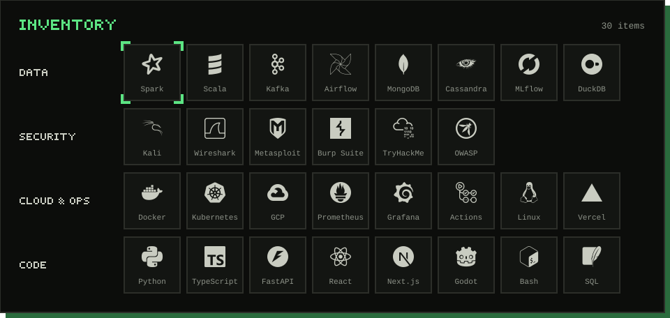

&nbsp;
&nbsp;

 

<picture>
  <source media="(prefers-color-scheme: light)" srcset="assets/titles/about-light.svg" />
  
</picture>

 

<picture>
  <source media="(prefers-color-scheme: light)" srcset="assets/titles/featured-light.svg" />
  
</picture>

  
  
  
  
  
  

  &nbsp;
  &nbsp;
  

 

<picture>
  <source media="(prefers-color-scheme: light)" srcset="assets/titles/quests-light.svg" />
  
</picture>

  
  
  
  

 

<picture>
  <source media="(prefers-color-scheme: light)" srcset="assets/titles/stack-light.svg" />
  
</picture>

 

<picture>
  <source media="(prefers-color-scheme: light)" srcset="assets/titles/certifications-light.svg" />
  
</picture>

 

<picture>
  <source media="(prefers-color-scheme: light)" srcset="assets/titles/activity-light.svg" />
  
</picture>

<picture>
  <source media="(prefers-color-scheme: dark)" srcset="https://raw.githubusercontent.com/javiersaguar/javiersaguar/output/snake-dark.svg" />
  <source media="(prefers-color-scheme: light)" srcset="https://raw.githubusercontent.com/javiersaguar/javiersaguar/output/snake-light.svg" />
  
</picture>

<picture>
  <source media="(prefers-color-scheme: light)" srcset="assets/footer-light.svg" />
  
</picture>
