

<picture><source media="(prefers-color-scheme: dark)" srcset="assets/header.svg" /><source media="(prefers-color-scheme: light)" srcset="assets/header-light.svg" /></picture>

<a href="https://www.linkedin.com/in/javier-saguar-46a3a7396/"><picture><source media="(prefers-color-scheme: dark)" srcset="assets/buttons/linkedin.svg" /><source media="(prefers-color-scheme: light)" srcset="assets/buttons/linkedin-light.svg" /></picture></a>&nbsp;
<a href="mailto:saguarjavier@gmail.com"><picture><source media="(prefers-color-scheme: dark)" srcset="assets/buttons/email.svg" /><source media="(prefers-color-scheme: light)" srcset="assets/buttons/email-light.svg" /></picture></a>&nbsp;
<a href="https://portfolio-ashy-three-x3r3sc9h9u.vercel.app"><picture><source media="(prefers-color-scheme: dark)" srcset="assets/buttons/portfolio.svg" /><source media="(prefers-color-scheme: light)" srcset="assets/buttons/portfolio-light.svg" />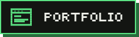</picture></a>

 

<picture>
  <source media="(prefers-color-scheme: dark)" srcset="assets/titles/about-dark.svg" />
  <source media="(prefers-color-scheme: light)" srcset="assets/titles/about-light.svg" />
  
</picture>

<picture><source media="(prefers-color-scheme: dark)" srcset="assets/about.svg" /><source media="(prefers-color-scheme: light)" srcset="assets/about-light.svg" /></picture>

 

<picture>
  <source media="(prefers-color-scheme: dark)" srcset="assets/titles/featured-dark.svg" />
  <source media="(prefers-color-scheme: light)" srcset="assets/titles/featured-light.svg" />
  
</picture>

  <a href="https://github.com/javiersaguar/HS-Maisa"><picture><source media="(prefers-color-scheme: dark)" srcset="assets/cards/albertitos.svg" /><source media="(prefers-color-scheme: light)" srcset="assets/cards/albertitos-light.svg" /></picture></a>
  <a href="https://github.com/javiersaguar/PIDS-Proyecto1"><picture><source media="(prefers-color-scheme: dark)" srcset="assets/cards/happytaxi.svg" /><source media="(prefers-color-scheme: light)" srcset="assets/cards/happytaxi-light.svg" /></picture></a>
  <a href="https://github.com/javiersaguar/BigData-Pipeline-Flight-Simulation"><picture><source media="(prefers-color-scheme: dark)" srcset="assets/cards/flight-delays.svg" /><source media="(prefers-color-scheme: light)" srcset="assets/cards/flight-delays-light.svg" /></picture></a>
  <a href="https://github.com/javiersaguar/Ciber-Tool"><picture><source media="(prefers-color-scheme: dark)" srcset="assets/cards/atalaya.svg" /><source media="(prefers-color-scheme: light)" srcset="assets/cards/atalaya-light.svg" /></picture></a>
  <a href="https://github.com/javiersaguar/EUROPEAN-BAD-DRIVERS"><picture><source media="(prefers-color-scheme: dark)" srcset="assets/cards/bad-drivers.svg" /><source media="(prefers-color-scheme: light)" srcset="assets/cards/bad-drivers-light.svg" /></picture></a>
  <a href="https://github.com/javiersaguar/Pokemon-FanGame"><picture><source media="(prefers-color-scheme: dark)" srcset="assets/cards/pokemon-spain.svg" /><source media="(prefers-color-scheme: light)" srcset="assets/cards/pokemon-spain-light.svg" /></picture></a>

  <a href="https://albertitos.vercel.app"><picture><source media="(prefers-color-scheme: dark)" srcset="assets/buttons/demo-albertitos.svg" /><source media="(prefers-color-scheme: light)" srcset="assets/buttons/demo-albertitos-light.svg" /></picture></a>&nbsp;
  <a href="https://happytaxi-javiers-projects-239a8bb6.vercel.app"><picture><source media="(prefers-color-scheme: dark)" srcset="assets/buttons/demo-happytaxi.svg" /><source media="(prefers-color-scheme: light)" srcset="assets/buttons/demo-happytaxi-light.svg" /></picture></a>&nbsp;
  <a href="https://javiersaguar.github.io/EUROPEAN-BAD-DRIVERS/"><picture><source media="(prefers-color-scheme: dark)" srcset="assets/buttons/demo-observatory.svg" /><source media="(prefers-color-scheme: light)" srcset="assets/buttons/demo-observatory-light.svg" /></picture></a>

<picture><source media="(prefers-color-scheme: dark)" srcset="assets/coursework.svg" /><source media="(prefers-color-scheme: light)" srcset="assets/coursework-light.svg" /></picture>

 

<picture>
  <source media="(prefers-color-scheme: dark)" srcset="assets/titles/quests-dark.svg" />
  <source media="(prefers-color-scheme: light)" srcset="assets/titles/quests-light.svg" />
  
</picture>

  <a href="https://poker-texas.vercel.app"><picture><source media="(prefers-color-scheme: dark)" srcset="assets/quests/poker.svg" /><source media="(prefers-color-scheme: light)" srcset="assets/quests/poker-light.svg" /></picture></a>
  <a href="https://wavelength-ten-blue.vercel.app"><picture><source media="(prefers-color-scheme: dark)" srcset="assets/quests/wavelength.svg" /><source media="(prefers-color-scheme: light)" srcset="assets/quests/wavelength-light.svg" /></picture></a>
  <a href="https://tabu-cartas.vercel.app"><picture><source media="(prefers-color-scheme: dark)" srcset="assets/quests/tabu.svg" /><source media="(prefers-color-scheme: light)" srcset="assets/quests/tabu-light.svg" /></picture></a>
  <a href="https://bet366-nine.vercel.app"><picture><source media="(prefers-color-scheme: dark)" srcset="assets/quests/bet366.svg" /><source media="(prefers-color-scheme: light)" srcset="assets/quests/bet366-light.svg" /></picture></a>

 

<picture>
  <source media="(prefers-color-scheme: dark)" srcset="assets/titles/stack-dark.svg" />
  <source media="(prefers-color-scheme: light)" srcset="assets/titles/stack-light.svg" />
  
</picture>

<picture>
  <source media="(prefers-color-scheme: dark)" srcset="assets/inventory.svg" />
  <source media="(prefers-color-scheme: light)" srcset="assets/inventory-light.svg" />
  
</picture>

 

<picture>
  <source media="(prefers-color-scheme: dark)" srcset="assets/titles/certifications-dark.svg" />
  <source media="(prefers-color-scheme: light)" srcset="assets/titles/certifications-light.svg" />
  
</picture>

  <picture><source media="(prefers-color-scheme: dark)" srcset="assets/certifications/google.svg" /><source media="(prefers-color-scheme: light)" srcset="assets/certifications/google-light.svg" /></picture>
  <picture><source media="(prefers-color-scheme: dark)" srcset="assets/certifications/tryhackme.svg" /><source media="(prefers-color-scheme: light)" srcset="assets/certifications/tryhackme-light.svg" />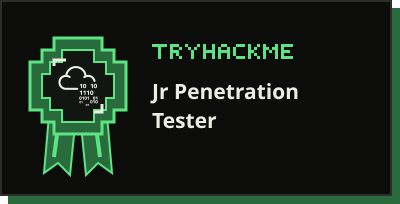</picture>

 

<picture>
  <source media="(prefers-color-scheme: dark)" srcset="assets/footer-dark.svg" />
  <source media="(prefers-color-scheme: light)" srcset="assets/footer-light.svg" />
  
</picture>
